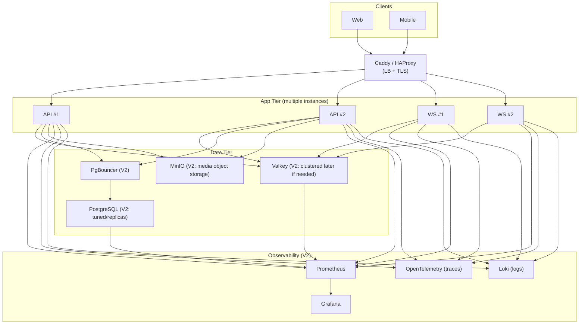

# Kids Games Platform — Debian LTS + Podman MVP Plan (for Cursor)

> Goal: Build a **free/open-source**, single-server MVP deployable on **Debian LTS** using **Podman** (rootless), designed with a **scalable architecture** that can later expand to multi-node / cloud.  
> Product: A modular “games platform” with replaceable games. Initial game: **Flash Cards** (words + image + pronunciation). Later: **Labyrinth draw game**, **Animal sounds**, and **multiplayer games** (tic-tac-toe, backgammon, etc. with bot or PvP).

---

## 0) Scope & Principles

### MVP scope (must ship)
- Applications:
  - backend API server is required for MVP
  - web client is required for MVP
  - mobile client is not part of MVP
- User registration + login
- Main menu to choose a game
- Flash Cards game:
  - Previous/Next
  - Shuffle
  - Mark “Known”
  - Track known count and progress per deck/language
  - English first; architecture supports multiple languages later
- Backend stores:
  - user profile
  - deck catalog metadata
  - user progress (known words, last position, stats)
- Deployment:
  - Podman rootless + `podman-compose`
  - Reverse proxy for localhost development
  - Local HTTPS support for development/testing
  - Postgres + Valkey
  - CI/CD deploy from GitHub Actions (SSH pull + restart) kept as future-ready template, not required for first localhost-only phase
- Testing:
  - Fast local tests for server, client, shared code, and database
  - Tests runnable at every implementation step
  - Functional tests plus static analysis / code quality checks

### Non-goals (for MVP)
- Complex animations
- Advanced bot AI
- Full event sourcing (optional later)
- Kubernetes (future phase)
- Massive realtime multiplayer (future phase) — only prepare foundation

### Design principles
- **Client does most work**: backend is “system of record”, minimal compute.
- **Stateless API**: scale by running more app instances later.
- **Externalized state**: Postgres for durable, Valkey for hot ephemeral.
- **Plugin-style games**: consistent interface, shared platform features.
- **Test-first increments**: every major feature must add or update tests that can run locally in seconds or a few minutes at most.

---

## 1) Architecture Overview

### Components (single server)
- **caddy**: localhost reverse proxy with optional local HTTPS; production Let’s Encrypt remains a later deployment concern
- **api**: Node.js + TypeScript (Fastify recommended)
- **worker**: background tasks (optional early; can be same image)
- **postgres**: durable storage
- **valkey**: cache/presence/rate limits/queues (optional in MVP but recommended)
- **prometheus + grafana**: optional but great signal (add after MVP v1)

### Client apps
- **web**: React + TypeScript
- **mobile**: React Native (thin client)
- Shared:
  - API client
  - Auth token handling
  - Game “shell” UI (menu, profile, points, settings)
  - Game plugin system (common interface)

---

## 2) Repo Layout (monorepo recommended)

```
kids-games-platform/
  apps/
    web/                  # React
    mobile/               # React Native
    api/                  # Fastify + TS
  packages/
    shared/               # shared types, validation schemas, API client
    game-sdk/             # game plugin interface + helpers
  infra/
    podman/
      compose.yml         # podman-compose (docker-compose compatible)
      caddy/
        Caddyfile
      scripts/
        deploy.sh
        backup.sh
        restore.sh
    sql/
      migrations/
  docs/
    architecture.md
    adr/                  # architecture decision records
  .github/workflows/
    deploy.yml
```

**Cursor tip**: Keep `packages/shared` and `packages/game-sdk` strongly typed — Cursor will refactor faster and safer.

---

## 3) Tech Choices (MVP)

### Backend
- Node.js + TypeScript
- **Fastify** (lean + good performance; easy JSON schema validation)
- `zod` or `@sinclair/typebox` for validation
- DB access: `pg` (node-postgres) + raw SQL migrations via **node-pg-migrate**
- Auth: email+password (bcrypt) + JWT (access + refresh)
- Storage for media in MVP: serve static assets from server (Caddy)
  Later: object storage (S3-compatible MinIO or cloud)

### Package manager
- **pnpm** with pnpm workspaces (`pnpm-workspace.yaml`)

### Data
- Postgres (durable truth)
- Valkey (recommended)
  - rate limiting
  - session cache
  - later: multiplayer room presence

### Infra
- Podman rootless + podman-compose
- Caddy for TLS

---

## 4) Data Model (Postgres) — MVP

### Core tables
- `users`:
  - id (uuid)
  - email (unique)
  - password_hash
  - display_name
  - created_at, updated_at

- `games`:
  - id (text)  # e.g. "flashcards", "labyrinth", "animals", "tictactoe"
  - title
  - status (enabled/disabled)
  - created_at

- `decks` (for flashcards; supports multiple languages later):
  - id (uuid)
  - game_id (fk -> games.id) = "flashcards"
  - language_code (e.g. "en", later "de", "es")
  - title
  - description
  - version (int)
  - created_at

- `cards`:
  - id (uuid)
  - deck_id (fk)
  - term (text)        # word
  - image_path (text)  # served from Caddy static or stored in DB as URL
  - audio_path (text)  # pronunciation audio
  - tags (text[])
  - created_at

- `user_deck_progress`:
  - user_id (fk)
  - deck_id (fk)
  - last_index (int)
  - known_count (int)
  - updated_at
  - PRIMARY KEY(user_id, deck_id)

**Preferred normalized approach** (scales better):
- `user_known_cards`:
  - user_id
  - deck_id
  - card_id
  - known_at
  - PRIMARY KEY(user_id, card_id)

### For points / scoreboard (platform-level)
- `user_points`:
  - user_id
  - total_points
  - updated_at

- `user_game_points`:
  - user_id
  - game_id
  - points
  - updated_at
  - PRIMARY KEY(user_id, game_id)

### For “resume after disconnect” (future multiplayer)
- `sessions`:
  - id (uuid)
  - game_id
  - mode ("single"|"pvp"|"bot")
  - state_json (jsonb)  # checkpoint
  - version (int)       # optimistic concurrency
  - updated_at

---

## 5) API Design (Fastify) — MVP

### Auth
- `POST /auth/register`
- `POST /auth/login`
- `POST /auth/refresh`
- `POST /auth/logout`

### Catalog
- `GET /games` (enabled games)
- `GET /flashcards/decks?lang=en`
- `GET /flashcards/decks/:deckId/cards` (accepts `page`/`limit` params; MVP returns all cards by default)

### Progress
- `GET /flashcards/decks/:deckId/progress`
- `POST /flashcards/decks/:deckId/known` (mark card known)
- `POST /flashcards/decks/:deckId/position` (save last index)
- `POST /points/add` (client-callable in MVP — intentionally insecure for localhost phase; TODO: server-authoritative in V2)

**Idempotency**
- Use `Idempotency-Key` header for writes that can be retried safely (especially points and progress).
- Store idempotency records in Postgres for a limited time window.

---

## 6) Game Plugin System (Client)

### Why
- Replaceable games
- Shared platform shell (auth, menu, points, settings, localization)

### `GameModule` interface (in `packages/game-sdk`)
```ts
export interface GameModule {
  id: string;                    // "flashcards", "labyrinth", ...
  title: string;
  icon?: string;
  routes: { path: string; component: React.ComponentType }[];
  requiresAuth: boolean;
  init?: (ctx: GameContext) => Promise<void>;
}
```

### Shared services in `GameContext`
- `api` client
- `auth` token store
- `i18n` helper
- `telemetry` (simple metrics/log events)
- `points` service

---

## 7) Flash Cards Game — Detailed MVP Spec

### UX
- Deck picker (language filter)
- Card screen:
  - Word
  - Image
  - Play pronunciation audio
  - Buttons:
    - Previous / Next
    - Mark Known
    - Shuffle (shuffle order)
- Stats header:
  - Known count / total
  - Deck completion %

### Behavior rules
- Known words persist per user+deck
- Shuffle affects browsing order only (store a session-local shuffled list; don’t persist unless desired)
- Save last position every N actions or every X seconds to reduce writes

### Offline / reconnect
- If connection drops:
  - allow local navigation
  - queue writes (mark known / position) locally and retry when online
- On resume:
  - merge queued updates; idempotency prevents duplication

---

## 8) Future Games (Design Notes)

### Labyrinth draw
- Mostly client-side canvas logic
- Backend:
  - store completed levels
  - points awards
  - unlocks

### Animal sounds
- Client plays audio, matches name
- Backend stores progress and points

### Multiplayer (tic-tac-toe first)
- WebSocket server in backend
- Room model:
  - `room_id`
  - participants
  - turn state
- Keep it simple:
  - server authoritative for moves
  - checkpoint state in Postgres every move (small JSON)
  - Valkey for presence and matchmaking queue
- Bot:
  - simple heuristic AI in backend or client (backend preferred for fairness)

---

## 9) Podman Deployment Plan (Debian LTS, rootless)

### Localhost-first phase (required first)
- Run all services locally with Podman rootless + `podman-compose`
- Expose app on localhost
- Support both:
  - HTTP on localhost for the simplest development loop
  - HTTPS on localhost for security-focused testing

### Production/server phase (future-ready, not required at first)
- Install Podman + podman-compose
- Create deploy user (non-root)
- Set up Caddy DNS + domain (A record to server IP) when a domain exists
- Open ports:
  - 22 (SSH)
  - 80/443 (Caddy)

### `infra/podman/compose.yml` services (example list)
- caddy
- api
- postgres
- valkey
- (optional) grafana, prometheus

### Secrets
- Use `.env` with file permissions `600`
- Separate:
  - `POSTGRES_PASSWORD`
  - `JWT_SECRET`
  - `REFRESH_SECRET`
  - `CADDY_EMAIL` (only needed for real public HTTPS)

### Backups (MVP but essential)
- Nightly pg_dump to disk + rotate
- Optional: rclone to a free/cheap remote later

---

## 10) Testing Strategy (required for every implementation step)

### Principles
- Tests must run locally.
- Default test runs must be fast enough for frequent use during development.
- Each new feature must add or update tests before the step is considered complete.
- Bugs fixed later must include regression tests where practical.
- Prefer smaller isolated tests first, then a limited number of higher-value integration/end-to-end tests.

### Test categories

#### 10.1 Static and code-quality checks
- Type checking for all TypeScript packages/apps
- Linting for server, client, and shared packages
- Format checking if a formatter is adopted
- Schema/type contract checks for shared DTOs and validation schemas

#### 10.2 Unit tests
- Shared utility functions
- Validation logic
- Auth helpers
- Flashcards domain logic:
  - shuffle behavior
  - known/progress calculations
  - offline queue merge helpers on the client
- Small React component logic where isolated unit tests add value

#### 10.3 API / server integration tests
- Auth endpoints:
  - register
  - login
  - refresh
  - logout
- Catalog endpoints:
  - list games
  - list decks
  - list cards
- Progress endpoints:
  - get progress
  - mark known
  - save position
- Validation and error cases:
  - invalid payloads
  - unauthorized requests
  - duplicate registration
  - invalid credentials
- Security-related behavior:
  - rate limiting behavior where practical
  - auth token handling
  - protected route access
  - idempotency handling for retried writes

#### 10.4 Database tests
- Migration smoke test from empty database
- Seed-data validation for the initial English flashcards deck
- Repository/data-access tests for core queries and writes
- Constraints/index tests for key uniqueness and relational integrity where practical

#### 10.5 Web client tests
- Auth flow screens
- Main menu rendering and game registry behavior
- Flashcards deck picker
- Flashcards card navigation:
  - previous/next
  - shuffle
  - mark known
  - progress display
- Offline queue behavior at UI/service level
- Error states and loading states

#### 10.6 End-to-end functional tests
- User can register or log in
- User can open flashcards
- User can browse cards
- User can mark cards as known
- User progress persists after reload
- Prefer a very small number of stable, high-value end-to-end tests to keep local runs fast

### Test execution cadence
- On each implementation step:
  - run lint + typecheck + relevant unit/integration tests
- On feature completion:
  - run full local test suite
- On bug fix:
  - add regression test and run affected suites

### Suggested quality gates per implementation step
- Step 1 scaffold:
  - workspace typecheck
  - lint config validation
  - test runners wired and passing empty/sample tests
- Step 2 API skeleton:
  - auth and health integration tests
  - validation tests
- Step 3 DB migrations + seed:
  - migration smoke test
  - seed verification tests
- Step 4 Web shell + plugin system:
  - React rendering tests
  - route/plugin registry tests
- Step 5 Flashcards UI + sync:
  - flashcards component tests
  - progress sync tests
  - small end-to-end user journey
- Step 6 Podman + reverse proxy:
  - local startup smoke test
  - health endpoint checks
  - optional local HTTPS smoke test
- Step 7 CI/CD:
  - CI runs lint, typecheck, tests, and build
- Step 8 observability:
  - health/metrics endpoint tests

### Local HTTPS testing
- Support local HTTPS to test secure cookies, mixed-content issues, and browser/security behavior before production.
- Preferred approaches:
  - use Caddy local certificates for localhost
  - or use a local development certificate tool such as `mkcert`
- Current decision for MVP:
  - use the simple localhost HTTPS setup first
  - browser warnings are acceptable in the early local phase
- Include at least one local smoke test path for HTTPS:
  - open app over `https://localhost`
  - call API over `https://localhost`
  - verify auth and API requests work without insecure fallbacks

### Recommended test tool stack
- Monorepo task runner:
  - workspace scripts only at first; add Turborepo later only if execution becomes too slow
- Static checks:
  - `typescript` for type checking
  - `eslint` for linting
  - `prettier --check` only if formatting is standardized in the repo
- Unit and integration tests:
  - `vitest` as the default test runner for shared code, server logic, and most client logic
  - Why:
    - fast local execution
    - simple TypeScript support
    - suitable for both unit and many integration tests
- API tests:
  - Fastify injection-based tests where possible
  - Why:
    - avoids full network startup for many server tests
    - keeps auth and endpoint tests fast
- Database tests:
  - dedicated test database with migration reset per run or per suite
  - Why:
    - validates real SQL behavior instead of mocks
- React tests:
  - `@testing-library/react`
  - Why:
    - tests behavior from the user perspective
    - fits forms, navigation, and flashcards UI well
- End-to-end browser tests:
  - `playwright`
  - Why:
    - covers the critical full flow across browser, frontend, and API
    - can also be used later for local HTTPS smoke checks
- Optional contract/mocking helpers:
  - `msw` for client-side API mocking in isolated UI tests
  - Why:
    - keeps component tests fast without requiring the real backend

### Suggested local test commands
- `lint`:
  - run ESLint across workspace
- `typecheck`:
  - run TypeScript type checking across workspace
- `test:unit`:
  - run Vitest unit tests
- `test:integration`:
  - run server integration and database-backed tests
- `test:web`:
  - run React component/service tests
- `test:e2e`:
  - run Playwright critical flow tests
- `test`:
  - run the fast default suite:
    - lint
    - typecheck
    - unit tests
    - selected integration tests
- `test:full`:
  - run everything including end-to-end tests

---

## 11) CI/CD (GitHub Actions → SSH Deploy)

Workflow:
1. lint/test
2. build api image
3. push to GHCR (free for public; for private check limits)
4. SSH to server:
   - `podman pull ...`
   - `podman-compose up -d`
   - run DB migrations

**Cursor prompt**: “Generate a GitHub Actions workflow that builds and pushes a Podman-compatible OCI image to GHCR and deploys via SSH to a Debian server running podman-compose.”

---

## 12) Observability (MVP+)

Start minimal:
- `/health` endpoint
- structured logs (pino)
- basic metrics endpoint (`/metrics`) for Prometheus (optional)

Add later:
- Prometheus + Grafana compose services
- Postgres exporter
- Node exporter

---

## 13) Security Checklist (MVP)

- HTTPS via Caddy
- Password hashing (bcrypt/argon2)
- JWT short-lived + refresh tokens
- Rate limiting (Valkey-backed) for:
  - login
  - register
  - progress writes
- Input validation on every endpoint
- Least privilege DB user
- Firewall + fail2ban
- Local HTTPS testing before production deployment
- Security-related test coverage for auth flows, protected routes, and retry/idempotency behavior

---

## 14) “Scalability Story” (what you’ll explain in interviews)

Even on one server:
- Stateless API containers
- Durable state in Postgres
- Hot state/caching in Valkey
- Idempotent writes
- Batched progress writes
- WebSocket scaling plan:
  - split api and ws services
  - add second node + load balancer later
- Clear upgrade path to Kubernetes/cloud

---

## 15) Cursor Execution Plan (step-by-step prompts)

### Step 1 — Scaffold repo
Prompt:
- “Create a monorepo with pnpm workspaces: apps/web, apps/mobile (placeholder only), apps/api, packages/shared, packages/game-sdk, infra/podman.”
- Add:
  - “Wire local lint, typecheck, unit test, and integration test commands so tests can run from the first step.”

### Step 2 — API foundation + DB schema + auth (merged)
Prompt:
- “Set up node-pg-migrate. Create SQL migrations for all MVP tables (users, games, decks, cards, user_deck_progress, user_known_cards, user_points, user_game_points). Add seed data for one English flashcards deck using placeholder SVG images and null audio paths. Implement Fastify + TypeScript API with auth routes (register, login, refresh, logout), JWT, protected routes, and repository/data-access layer.”
- Add:
  - “Create migration smoke tests, seed validation tests, repository tests, and auth integration tests.”

### Step 3 — Catalog and flashcards API
Prompt:
- “Implement catalog endpoints (GET /games, GET /flashcards/decks, GET /flashcards/decks/:deckId/cards returning all cards by default in MVP), progress endpoints (GET/POST known/position), and POST /points/add (client-callable in MVP localhost phase — add a TODO comment for V2 server-side enforcement). Add idempotency and rate limiting.”
- Add:
  - “Create integration tests for catalog, progress, idempotency, and rate limiting behavior.”

### Step 4 — Web app shell + game plugin system
Prompt:
- “Create a React app with auth, main menu, and a plugin-based game registry. Implement FlashcardsGame as first module.”
- Add:
  - “Create component and route tests for the app shell and plugin registry.”

### Step 5 — Flashcards UI + progress sync
Prompt:
- “Implement flashcards UI with prev/next/shuffle/known, save progress with idempotency keys and offline queue.”
- Add:
  - “Create tests for flashcards behavior, progress persistence, and offline queue logic.”

### Step 6 — Podman compose + Caddy HTTPS
Prompt:
- “Generate podman-compose YAML for caddy/api/postgres/valkey and Caddyfile with reverse proxy to api and static hosting for assets, optimized for localhost development first.”
- Add:
  - “Create local startup smoke tests and an optional localhost HTTPS smoke test.”

### Step 7 — CI/CD
Prompt:
- “Create GitHub Actions workflow to build/push images and SSH deploy to my Debian server.”
- Add:
  - “Run lint, typecheck, unit, integration, and selected end-to-end tests in CI before build/deploy.”

### Step 8 — Observability (optional)
Prompt:
- “Add /metrics endpoint and compose services for prometheus+grafana with minimal dashboards.”

---

## 16) Clarified current decisions
1. Domain/HTTPS:
   - no public domain yet
   - develop on localhost first
   - support optional local HTTPS for development/testing
2. Flashcards content:
   - import from simple JSON or CSV files
   - no admin upload UI in MVP
   - seed images use free/open placeholder SVGs
   - `audio_path` is nullable; no audio files in MVP seed; audio UI is wired but silent if path is null
3. Authentication:
   - keep MVP to email + password
4. MVP app scope:
   - one server application (`api`)
   - one client application (`web`)
   - `apps/mobile` exists as a README placeholder stub only; no implementation
5. Package manager: pnpm workspaces
6. SQL migrations: node-pg-migrate with raw SQL files
7. Points API: `POST /points/add` is client-callable in MVP (localhost only); explicitly marked as accepted security gap with TODO for V2


---

# 17) Scalable V2 Additions (DO NOT IMPLEMENT NOW — Reference Only)

> **Important:** This section is **NOT part of the MVP** and should **not be executed now**.  
> It exists purely as **future reference** and as **design constraints** to keep in mind during MVP implementation, so that adding these capabilities later is straightforward.

## V2.1 — Multi-instance scaling (still self-hosted)
- **Split API and WS** into separate services/containers:
  - `api` (REST) and `realtime` (WebSocket)
- Add a **load balancer** in front (still free):
  - Caddy (multiple upstreams) or HAProxy
- Make all services **stateless**:
  - Store sessions/checkpoints in Postgres
  - Store presence/matchmaking in Valkey

## V2.2 — Database scaling and reliability
- Add **PgBouncer** for Postgres connection pooling (reduces DB load)
- Introduce **read replicas** (later, if you move to managed DB or multi-node)
- Partition hot tables:
  - `user_known_cards` and `sessions/events` by time or by deck/user ranges
- Backup strategy upgrade:
  - Point-in-time restore (WAL archiving) when needed
  - Offsite backups (rclone) to remote storage

## V2.3 — Real-time multiplayer foundation (beyond basic)
- Adopt a **room server** model:
  - `room_id`, participants, authoritative state
- Move matchmaking to Valkey:
  - sorted sets / lists for queues
- Add **reconnect tokens** for live rooms:
  - allow rejoin within X seconds/minutes
- Persist minimal checkpoints per move in Postgres (small JSON)

## V2.4 — Background jobs and messaging
- Introduce a real queue system if required:
  - **NATS** (lightweight) or **RabbitMQ**
- Add Outbox pattern:
  - business transaction + “event to publish” in same Postgres transaction
- Use workers for:
  - leaderboard aggregation
  - deck import processing
  - periodic cleanup and analytics rollups

## V2.5 — Content storage (media) and CDN-like behavior (self-hosted)
- Replace “static assets on disk” with:
  - **MinIO (S3-compatible)** for images/audio
- Optional caching layer:
  - Caddy caching rules or Varnish
- Version decks/media:
  - immutable URLs for cache friendliness

## V2.6 — Security hardening and compliance upgrades
- Add optional SSO:
  - OIDC providers (Google/Apple) or Keycloak federation
- Add WAF-like controls (still free-ish):
  - CrowdSec rules, rate limiting, IP reputation
- Secrets management:
  - sops + age, or Vault (later, only if needed)

## V2.7 — Observability upgrades
- Add log aggregation:
  - **Loki** + Grafana
- Add tracing:
  - OpenTelemetry Collector + Jaeger/Tempo
- Add alerting:
  - Alertmanager + basic on-call routing (email)

## V2.8 — Kubernetes / Cloud migration (future)
- Replace podman-compose with Kubernetes manifests/Helm
- Move to managed services when justified:
  - managed Postgres, managed Redis, object storage, CDN
- Keep the same app contracts:
  - stateless services
  - externalized state
  - health endpoints, metrics, tracing

## V2.9 — Performance and load validation (future)
- Add load testing:
  - **k6** or **Artillery** for REST and WS
- Define SLOs:
  - latency targets, error budgets
- Run controlled experiments:
  - cache hit ratio, DB write frequency, checkpoint intervals

---

# 18) Visual Architecture Diagram (MVP + V2 markers)

## 17.1 MVP Diagram (single Debian server, free stack)

```mermaid
flowchart TB
  subgraph Client["Clients"]
    W["Web (React + TS)"]
    M["Mobile (React Native)"]
  end

  subgraph Server["Debian LTS Server (Podman rootless)"]
    RP["Caddy (HTTPS + Reverse Proxy)"]
    API["API (Node.js + TS + Fastify)"]
    WS["Realtime (WebSockets)\n(MVP: optional / minimal)"]
    PG["PostgreSQL\n(durable truth)"]
    VK["Valkey\n(cache/presence/rate-limit)"]
    OBS["Observability (optional)\nPrometheus + Grafana"]
  end

  W -->|HTTPS REST| RP
  M -->|HTTPS REST| RP
  W -->|WSS (future multiplayer)| RP
  M -->|WSS (future multiplayer)| RP

  RP --> API
  RP --> WS

  API -->|SQL| PG
  API -->|Cache / rate limit| VK
  WS -->|presence / rooms| VK
  WS -->|checkpoints (future)| PG

  API -->|/metrics (optional)| OBS
  PG -->|exporter (optional)| OBS
  VK -->|exporter (optional)| OBS
```

## 17.2 V2 Scaling Overlay (for reference only)

Key future changes (do not implement now):
- Add multiple `API` and `WS` instances
- Add load balancing (Caddy upstreams / HAProxy)
- Add PgBouncer for Postgres
- Add MinIO for media storage
- Add NATS/RabbitMQ if queues become necessary




---

# 19) Mobile Store Readiness Checklist (DO NOT IMPLEMENT ALL AT ONCE)

> Purpose: Ensure the **React Native** app can be shipped to **Apple App Store** and **Google Play**, while keeping the MVP lightweight.  
> Treat this as a **checklist**: implement items only when you are close to publishing.

## 18.1 Recommended mobile build approach (MVP-friendly)
- Prefer **Expo** for the first store release:
  - faster iteration, easier signing/builds, simpler permissions and asset pipeline
  - you can “prebuild/eject” later if native modules become necessary
- Keep the mobile app a **thin client**:
  - UI + offline queue + sync
  - minimal device-specific logic

## 18.2 Networking and security requirements (must-have for stores)
- **HTTPS only** (already covered via Caddy + TLS)
- Enforce API base URL as `https://...` and WSS as `wss://...`
- Token storage:
  - **Do NOT store JWTs in plain AsyncStorage**
  - Use **Expo SecureStore** (Expo) or **react-native-keychain** (bare RN)
- Use short-lived access tokens + refresh tokens (already in plan)
- Add basic certificate/hostname sanity checks (avoid accepting insecure endpoints)

## 18.3 Privacy, compliance, and store metadata (must-have at publish time)
- Create a **Privacy Policy** webpage (can be simple static page on your domain)
- Track what data you store:
  - email, display name, progress, points, deck usage
- Avoid collecting unnecessary PII
- If you add analytics later, disclose it in privacy policy and store forms
- Apple “App Privacy” and Google “Data safety” forms require accurate disclosure

## 18.4 In-app purchases / monetization (future — important rule)
- If you ever sell digital content/features inside iOS app:
  - Apple requires **In-App Purchases** (IAP)
  - Do not bypass with external payment links in the app UI
- For MVP, avoid monetization in-app to keep release simple

## 18.5 Tablet support (iPad + Android tablets)
- Implement responsive layouts:
  - avoid fixed pixel sizes
  - use flex layouts and scalable typography
- Test on at least:
  - one small phone size
  - one large phone size
  - one tablet size
- Consider split-view and landscape orientation support (at least basic)

## 18.6 Audio & media considerations (flashcards pronunciation, animal sounds)
- Use platform-safe audio libraries:
  - Expo AV (Expo) or a stable RN audio package (bare)
- Support “silent mode” expectations on iOS:
  - decide whether pronunciation should play when silent (usually **no** by default)
- Keep assets optimized:
  - compress images and audio files
  - lazy-load large assets (don’t ship massive bundles in the app binary)

## 18.7 Offline behavior and reconnect (mobile-specific must-have)
- Implement:
  - offline queue for progress writes
  - exponential backoff for retries
  - idempotency keys for write endpoints (already planned)
- WebSockets:
  - implement reconnect with backoff
  - add a lightweight resume token (future multiplayer)

## 18.8 Build, signing, and release pipeline (when ready to publish)
- Apple:
  - bundle identifier, certificates, provisioning profiles
  - App Store screenshots, app icon, versioning
- Google:
  - app signing key, release tracks (internal testing → closed → production)
- CI/CD for mobile:
  - optional early; you can build locally first
  - later consider **EAS Build** (Expo) for repeatable builds

## 18.9 Operational checklist (pre-release sanity)
- Verify:
  - all API endpoints behind HTTPS
  - rate limiting enabled for auth endpoints
  - password policy reasonable
  - account deletion workflow (even basic) — recommended for store trust
- Crash reporting (optional early):
  - can add later; don’t block MVP on it

## 18.10 Cursor prompts to implement store readiness incrementally
- “Add secure token storage using Expo SecureStore and update auth flows accordingly.”
- “Create a privacy policy static page and host it via Caddy.”
- “Make the mobile UI responsive for tablets; add layout tests or device preview notes.”
- “Implement offline queue for progress updates with idempotency keys.”
