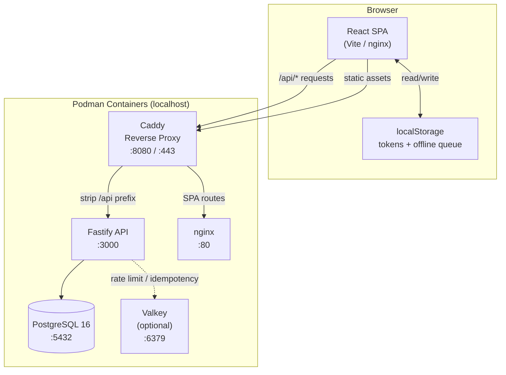
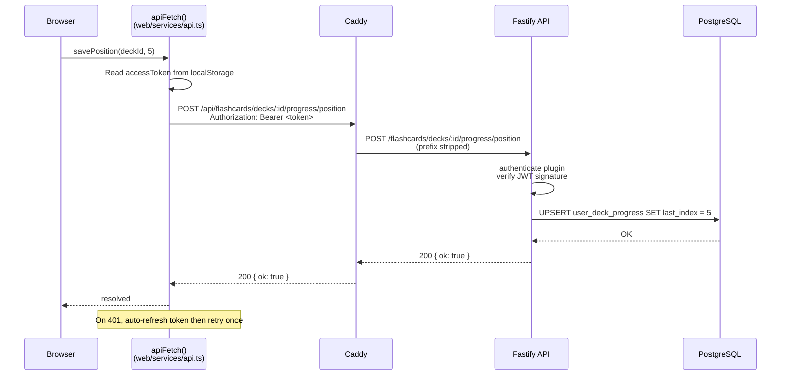
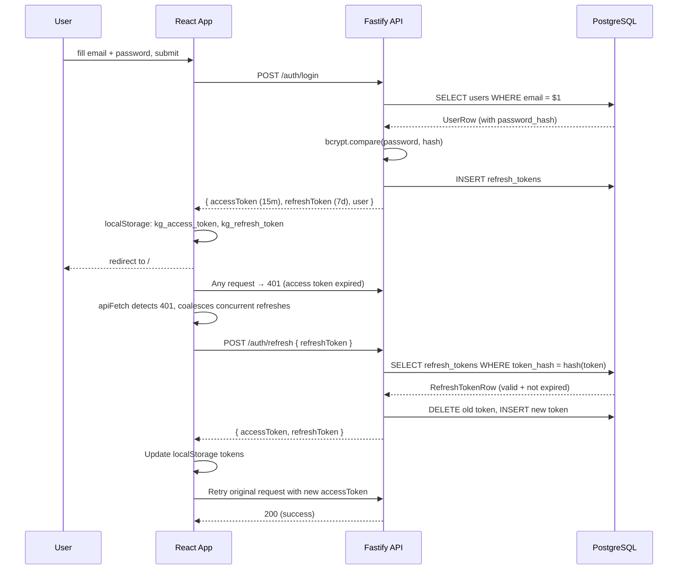
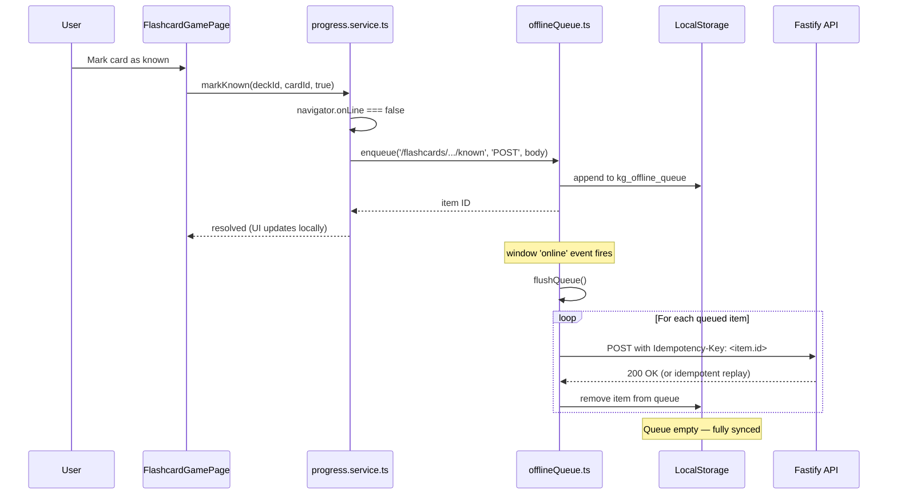
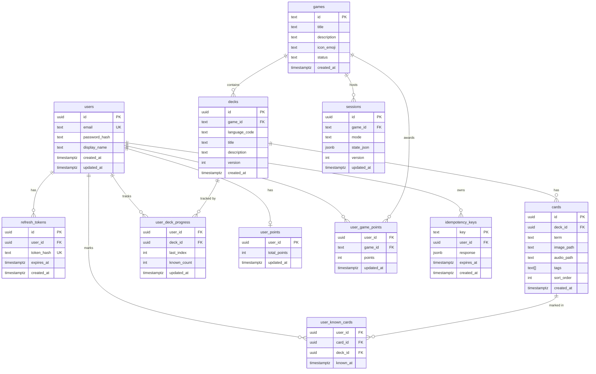
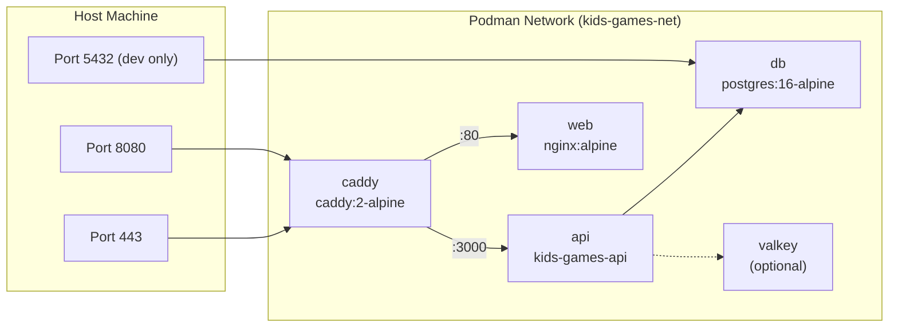
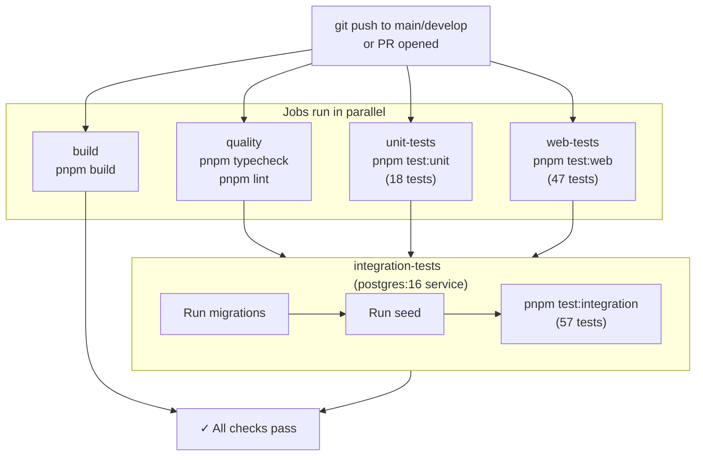
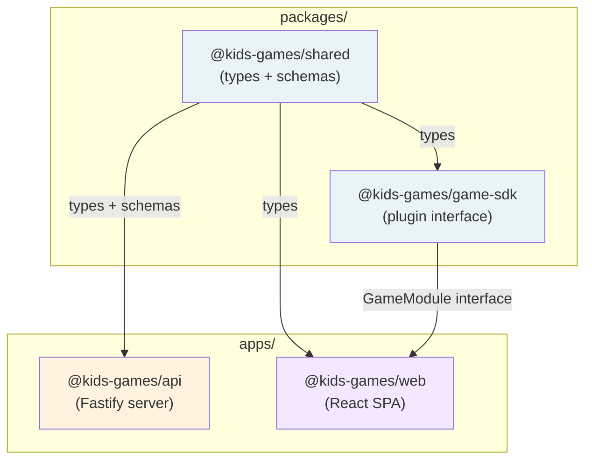

# Kids Games Platform — Architecture Reference

A complete technical reference covering system design, data flow, module structure, database schema, test strategy, and extension points.

---

## Table of Contents

1. [System Overview](#system-overview)
2. [Monorepo Structure](#monorepo-structure)
3. [High-Level Architecture Diagram](#high-level-architecture-diagram)
4. [Request Flow — Authenticated API Call](#request-flow--authenticated-api-call)
5. [Auth Sequence — Login & Token Refresh](#auth-sequence--login--token-refresh)
6. [Offline Sync Sequence](#offline-sync-sequence)
7. [Database Schema](#database-schema)
8. [Backend — API Package](#backend--api-package)
9. [Frontend — Web Package](#frontend--web-package)
10. [Shared Package](#shared-package)
11. [Game SDK Package](#game-sdk-package)
12. [Infrastructure & Containers](#infrastructure--containers)
13. [CI/CD Pipeline](#cicd-pipeline)
14. [Test Strategy](#test-strategy)
15. [Integrating a New API Resource](#integrating-a-new-api-resource)
16. [Integrating a New Game](#integrating-a-new-game)
17. [Module Dependency Map](#module-dependency-map)

---

## System Overview

Kids Games Platform is a **monorepo** of four packages targeting a single-server localhost-first deployment. The architecture is intentionally simple: one Fastify API, one React SPA, one PostgreSQL database, and a Caddy reverse proxy.

```
Browser
  └── Caddy (port 8080/443)
        ├── /api/* → Fastify API (port 3000)
        └── /*     → Nginx serving React SPA (port 80)
                         └── API calls back through Caddy /api prefix
```

**Key design properties:**

- **Offline-capable client** — progress writes queue to localStorage when offline; flush on reconnect
- **Idempotent writes** — every progress mutation uses a UUID Idempotency-Key so safe retries don't duplicate data
- **Plugin-ready game registry** — `game-sdk` defines a `GameModule` interface for future games; flashcards is the MVP reference implementation
- **Schema-first validation** — Zod schemas in the shared package are the single source of truth for all request/response contracts

---

## Monorepo Structure

```
kids-games-platform/
├── apps/
│   ├── api/                          # Fastify backend
│   │   ├── src/
│   │   │   ├── index.ts              # Entry point (listen)
│   │   │   ├── app.ts                # App factory (createApp)
│   │   │   ├── config.ts             # Env-var config with testConfig
│   │   │   ├── types.ts              # Fastify type augmentations
│   │   │   ├── mappers.ts            # DB row → API DTO mappers
│   │   │   ├── routes/
│   │   │   │   ├── auth.ts           # POST /auth/*
│   │   │   │   ├── games.ts          # GET /games, GET /games/:id
│   │   │   │   ├── flashcards.ts     # GET+POST /flashcards/*
│   │   │   │   ├── points.ts         # GET+POST /points
│   │   │   │   └── health.ts         # GET /health
│   │   │   ├── repositories/
│   │   │   │   ├── user.repository.ts
│   │   │   │   ├── deck.repository.ts
│   │   │   │   ├── progress.repository.ts
│   │   │   │   ├── game.repository.ts
│   │   │   │   ├── token.repository.ts
│   │   │   │   └── points.repository.ts
│   │   │   ├── services/
│   │   │   │   └── auth.service.ts   # Password hashing, token logic
│   │   │   ├── plugins/
│   │   │   │   ├── auth.ts           # JWT preHandler decorator
│   │   │   │   ├── db.ts             # Pool lifecycle plugin
│   │   │   │   └── rateLimit.ts      # Rate-limit plugin
│   │   │   └── db/
│   │   │       ├── client.ts         # Pool singleton + createPool
│   │   │       ├── migrate.ts        # node-pg-migrate runner
│   │   │       ├── seed.ts           # Seed script
│   │   │       ├── reset.ts          # Drop + migrate + seed
│   │   │       ├── migrations/
│   │   │       │   └── 001_initial_schema.sql
│   │   │       └── seed-data/
│   │   │           └── english-deck.json
│   │   └── src/tests/
│   │       ├── auth.service.test.ts         # Unit
│   │       ├── health.test.ts               # Unit
│   │       ├── auth.integration.test.ts     # Integration
│   │       ├── flashcards.integration.test.ts
│   │       ├── games.integration.test.ts
│   │       ├── migration.integration.test.ts
│   │       ├── repositories.integration.test.ts
│   │       └── seed.integration.test.ts
│   │
│   ├── web/                          # React SPA frontend
│   │   ├── src/
│   │   │   ├── main.tsx              # React root
│   │   │   ├── App.tsx               # Router definition
│   │   │   ├── pages/
│   │   │   │   ├── LoginPage.tsx
│   │   │   │   ├── RegisterPage.tsx
│   │   │   │   ├── MenuPage.tsx
│   │   │   │   └── flashcards/
│   │   │   │       ├── DeckPickerPage.tsx
│   │   │   │       └── FlashcardGamePage.tsx
│   │   │   ├── components/
│   │   │   │   ├── Layout.tsx
│   │   │   │   ├── ProtectedRoute.tsx
│   │   │   │   └── flashcards/
│   │   │   │       ├── FlashCard.tsx
│   │   │   │       └── ProgressBar.tsx
│   │   │   ├── services/
│   │   │   │   ├── api.ts            # apiFetch + auto-refresh
│   │   │   │   ├── auth.service.ts   # Login/register/token storage
│   │   │   │   ├── progress.service.ts  # Deck progress reads/writes
│   │   │   │   └── offlineQueue.ts   # localStorage write queue
│   │   │   ├── hooks/
│   │   │   │   └── useOnlineStatus.ts
│   │   │   └── test-setup.ts         # Vitest global setup
│   │   ├── src/tests/                # Component tests (vitest+jsdom)
│   │   ├── e2e/                      # Playwright tests
│   │   └── playwright.config.ts
│   │
│   └── mobile/                       # Stub — README only
│
├── packages/
│   ├── shared/                       # Shared types + Zod schemas
│   │   └── src/
│   │       ├── index.ts
│   │       ├── types.ts              # User, Game, Deck, Card, etc.
│   │       └── schemas.ts            # Zod: RegisterSchema, LoginSchema, etc.
│   │
│   └── game-sdk/                     # Plugin interface for future games
│       └── src/
│           ├── index.ts
│           └── types.ts              # GameModule, GameContext, ApiClient, etc.
│
├── infra/
│   ├── podman/
│   │   ├── compose.yml               # Full-stack container orchestration
│   │   ├── Dockerfile.api            # Multi-stage API image
│   │   ├── Dockerfile.web            # Multi-stage web image (nginx)
│   │   ├── nginx.conf                # SPA fallback config
│   │   ├── smoke-test.sh             # Post-deploy health verification
│   │   └── caddy/Caddyfile           # Reverse proxy routing rules
│   └── sql/
│       └── migrations/               # Symlink to apps/api/src/db/migrations
│
├── .github/
│   └── workflows/ci.yml             # GitHub Actions pipeline
│
└── scripts/
    └── dev-db.sh                    # Local database container helper
```

---

## High-Level Architecture Diagram



---

## Request Flow — Authenticated API Call



---

## Auth Sequence — Login & Token Refresh



---

## Offline Sync Sequence



---

## Database Schema



**Compound primary keys:**
- `user_deck_progress` — PK `(user_id, deck_id)`
- `user_known_cards` — PK `(user_id, card_id)`
- `user_game_points` — PK `(user_id, game_id)`

**Notable design decisions:**
- `user_known_cards` stores `deck_id` as a denormalized convenience column for fast per-deck known-card queries without joining through `cards`
- `idempotency_keys` expire after 24 hours; only the API checks them — the client never reads them
- `sessions` table is a future placeholder for multiplayer/PvP mode — not used in MVP
- `audio_path` is nullable; MVP ships with null values for all cards

---

## Backend — API Package

### Application Factory

```
createApp({ logger, databaseUrl })
   │
   ├── new Fastify({ logger: pino | silent })
   ├── register @fastify/cors  (allowed origins from config)
   ├── register dbPlugin       (initPool → PostgreSQL connection)
   ├── register authPlugin     (@fastify/jwt → app.authenticate decorator)
   ├── register rateLimitPlugin
   │
   └── register routes
         ├── healthRoutes    (GET /health)
         ├── authRoutes      (POST /auth/*)
         ├── gameRoutes      (GET /games, GET /games/:id)
         ├── flashcardRoutes (GET+POST /flashcards/*)
         └── pointsRoutes    (GET+POST /points)
```

### Request Lifecycle

```
Incoming HTTP request
   │
   ├── CORS check
   ├── Rate limit check (auth routes: 10 req/min)
   ├── Route matching
   ├── [optional] app.authenticate preHandler
   │     ├── Verify JWT signature
   │     └── Attach request.user = { userId, email }
   ├── Route handler
   │     ├── Validate request body (Zod .safeParse)
   │     ├── Call repository functions (pg queries)
   │     └── Return JSON
   └── Pino access log
```

### Repository Pattern

All database access goes through `repositories/`. They accept an explicit `pg.Pool` parameter rather than importing a global, enabling clean test isolation:

```typescript
// Usage in route handlers:
import { getPool } from '../db/client.js';
import * as deckRepo from '../repositories/deck.repository.js';

const decks = await deckRepo.findDecks(getPool(), 'flashcards', lang);

// Usage in tests (test DB pool injected directly):
const decks = await deckRepo.findDecks(testPool, 'flashcards', 'en');
```

### Auth Plugin

The `authenticate` decorator is added to the Fastify instance in `plugins/auth.ts`:

```typescript
// Applied per-route:
app.get('/protected', { onRequest: [app.authenticate] }, handler)

// Available in handler after:
request.user.userId  // UUID string
request.user.email   // string
```

---

## Frontend — Web Package

### Routing Tree

```
App.tsx (BrowserRouter)
├── /login                → LoginPage
├── /register             → RegisterPage
├── /                     → ProtectedRoute → MenuPage
├── /flashcards           → ProtectedRoute → DeckPickerPage
└── /flashcards/:deckId   → ProtectedRoute → FlashcardGamePage
```

`ProtectedRoute` checks `isLoggedIn()` (reads `kg_access_token` from localStorage). On failure, it redirects to `/login?from=<original-path>`.

### Service Layer

```
apiFetch(path, options)
   │
   ├── Prepend /api base URL
   ├── If options.auth: inject Authorization header from localStorage
   ├── fetch()
   ├── On 401: call refreshTokens() then retry once
   ├── Parse JSON response
   └── Throw ApiError on non-2xx

auth.service.ts
   ├── login() → apiFetch POST /auth/login → store tokens
   ├── register() → apiFetch POST /auth/register → store tokens
   ├── logout() → apiFetch POST /auth/logout → clear tokens
   └── isLoggedIn() → !!localStorage.getItem('kg_access_token')

progress.service.ts
   ├── getDeckProgress(deckId) → GET /flashcards/decks/:id/progress
   ├── savePosition(deckId, index)
   │     ├── if offline → enqueue()
   │     └── else → POST .../progress/position (+ flush queue)
   └── markKnown(deckId, cardId, known)
         ├── if offline → enqueue()
         └── else → POST .../progress/known (+ flush queue)

offlineQueue.ts
   ├── enqueue(path, method, body) → push to localStorage array
   ├── flushQueue() → send all items, remove on success
   └── auto-flush on window 'online' event
```

### State Management

The app has no global state library (no Redux, Zustand, etc.). State is local to each page component via `useState`/`useEffect`. The only persistent state is in `localStorage` (auth tokens, offline queue).

---

## Shared Package

**`packages/shared/src/types.ts`** — TypeScript interfaces shared by both API and web:

| Type | Fields |
|------|--------|
| `User` | id, email, displayName, createdAt? |
| `Game` | id, title, status, description?, iconEmoji? |
| `Deck` | id, gameId, languageCode, title, description, cardCount, version, createdAt |
| `Card` | id, deckId, term, imagePath, audioPath, tags |
| `DeckProgress` | userId, deckId, lastIndex, knownCount, totalCards, knownCardIds[], updatedAt |
| `AuthTokens` | accessToken, refreshToken, expiresIn? |
| `ApiError` | statusCode, error, message |

**`packages/shared/src/schemas.ts`** — Zod validation schemas used in API route handlers and (optionally) web form validation:

| Schema | Validates |
|--------|-----------|
| `RegisterSchema` | email (valid format), password (8+ chars), displayName (2–50 chars) |
| `LoginSchema` | email (any), password (1+ chars) |
| `RefreshSchema` | refreshToken (non-empty string) |
| `MarkKnownSchema` | cardId (UUID), known (boolean) |
| `SavePositionSchema` | lastIndex (int ≥ 0) |
| `AddPointsSchema` | gameId (non-empty string), points (positive integer) |

The API uses `schema.safeParse(request.body)` and returns `400` with the first Zod error message on failure.

---

## Game SDK Package

**`packages/game-sdk/src/types.ts`** — Interfaces for future pluggable games:

```typescript
interface GameModule {
    id: string;                         // Unique game identifier (e.g., "flashcards")
    title: string;
    description: string;
    iconEmoji: string;
    routes: GameRoute[];                // { path, component } pairs
    requiresAuth: boolean;
    init?: (ctx: GameContext) => Promise<void>;
}

interface GameContext {
    api: ApiClient;                     // Typed HTTP client
    auth: AuthStore;                    // Token accessor
    i18n: I18nHelper;                   // Locale + translation
    points: PointsService;              // Points award helper
}
```

**Current status:** The `FlashcardGamePage` is hard-wired in `App.tsx` — the SDK is not yet integrated. The `GameModule` interface defines what a future game plugin would export, and `GameContext` describes the runtime services injected into it.

---

## Infrastructure & Containers

### Container Topology



### Build Stages

**API image (`Dockerfile.api`):**
```
base (node:22-alpine + corepack)
  └── deps (pnpm install --frozen-lockfile)
        └── build (pnpm build → dist/)
              └── runtime (node:22-alpine)
                    copies: dist/, node_modules/, migrations/
                    CMD: node dist/index.js
```

**Web image (`Dockerfile.web`):**
```
base (node:22-alpine + corepack)
  └── deps (pnpm install)
        └── build (vite build → dist/)
              └── runtime (nginx:alpine)
                    copies: dist/ → /usr/share/nginx/html
                    nginx: SPA fallback, gzip, port 80
```

### Caddyfile Routing

```
localhost {
    handle /api/* {
        uri strip_prefix /api      # Remove /api prefix before forwarding
        reverse_proxy api:3000     # Forward to Fastify
    }
    handle {
        reverse_proxy web:80       # All other paths → SPA
    }
}
```

The web React app makes all API calls to `/api/...` (relative URL), which Caddy intercepts and strips the prefix before reaching Fastify.

---

## CI/CD Pipeline



All jobs use:
- `pnpm/action-setup@v4` (version 9)
- `actions/setup-node@v4` (Node 20)
- pnpm cache keyed on `kids-games-platform/pnpm-lock.yaml`
- `pnpm install --frozen-lockfile` (no lockfile drift)

---

## Test Strategy

### Test Pyramid

```
        ┌──────────┐
        │  E2E     │  Playwright — 2 tests (full browser flow)
        │  (slow)  │  Requires full stack running
        ├──────────┤
        │  Web     │  vitest + jsdom + @testing-library — 47 tests
        │ Component│  All API calls mocked with vi.mock
        ├──────────┤
        │Integration│ vitest + real PostgreSQL — 57 tests
        │  (API)   │  Isolated test database (kids_games_test)
        ├──────────┤
        │   Unit   │  vitest — 18 tests
        │  (fast)  │  No DB, no network, pure logic
        └──────────┘
```

### Integration Test Isolation

Integration tests create their own `createApp()` instance configured with `testConfig.databaseUrl` (the test DB). Each test file:

1. Creates an app instance in `beforeAll`
2. Cleans up test-specific data (not seed data)
3. Closes the app (and DB pool) in `afterAll`
4. Files run **sequentially** (`fileParallelism: false` in vitest config) to avoid pool singleton conflicts

The `createPool()` helper is used in migration/seed tests to bypass the singleton, getting a fresh pool without affecting the global app state.

### Web Component Test Isolation

Every test file mocks its dependencies with `vi.mock()`:

```typescript
vi.mock('../services/api.js', () => ({ apiFetch: vi.fn() }));
vi.mock('../services/auth.service.js', () => ({ isLoggedIn: vi.fn(() => true) }));
vi.mock('../services/progress.service.js', () => ({
    getDeckProgress: vi.fn().mockResolvedValue({ lastIndex: 0, knownCount: 0, knownCardIds: [] }),
    savePosition: vi.fn().mockResolvedValue(undefined),
    markKnown: vi.fn().mockResolvedValue(undefined),
}));
```

`vi.clearAllMocks()` in `beforeEach` resets call counts and implementations between tests.

**Test file → component mapping:**

| Test file | Component tested | Mocks |
|-----------|-----------------|-------|
| `MenuPage.test.tsx` | `MenuPage` | apiFetch, isLoggedIn, useNavigate |
| `DeckPickerPage.test.tsx` | `DeckPickerPage` | apiFetch, isLoggedIn, getDeckProgress |
| `FlashcardGamePage.test.tsx` | `FlashcardGamePage` | apiFetch, isLoggedIn, progress.service |
| `ProtectedRoute.test.tsx` | `ProtectedRoute` | isLoggedIn |
| `ProgressBar.test.tsx` | `ProgressBar` | (none — pure UI) |
| `offlineQueue.test.ts` | `offlineQueue.ts` | apiFetch, localStorage |
| `progressService.test.ts` | `progress.service.ts` | apiFetch, offlineQueue, navigator.onLine |

---

## Integrating a New API Resource

Example: adding a `badges` system (user achievements).

### 1. Database migration

Create `apps/api/src/db/migrations/002_badges.sql`:

```sql
-- Up
CREATE TABLE badges (
    id TEXT PRIMARY KEY,
    title TEXT NOT NULL,
    description TEXT DEFAULT '',
    icon_emoji TEXT DEFAULT '🏅'
);

CREATE TABLE user_badges (
    user_id UUID NOT NULL REFERENCES users(id) ON DELETE CASCADE,
    badge_id TEXT NOT NULL REFERENCES badges(id),
    awarded_at TIMESTAMPTZ DEFAULT NOW(),
    PRIMARY KEY (user_id, badge_id)
);
```

Run: `pnpm db:migrate`

### 2. Repository

Create `apps/api/src/repositories/badge.repository.ts`:

```typescript
import type pg from 'pg';

export async function getUserBadges(pool: pg.Pool, userId: string) {
    const result = await pool.query(
        `SELECT b.* FROM badges b
         JOIN user_badges ub ON b.id = ub.badge_id
         WHERE ub.user_id = $1`,
        [userId]
    );
    return result.rows;
}
```

### 3. Route

Create `apps/api/src/routes/badges.ts`:

```typescript
import type { FastifyInstance } from 'fastify';
import { getPool } from '../db/client.js';
import * as badgeRepo from '../repositories/badge.repository.js';

export async function badgeRoutes(app: FastifyInstance) {
    app.get('/badges', { onRequest: [app.authenticate] }, async (request, reply) => {
        const badges = await badgeRepo.getUserBadges(getPool(), request.user.userId);
        return reply.send(badges);
    });
}
```

### 4. Register in app.ts

```typescript
import { badgeRoutes } from './routes/badges.js';
// ...
await app.register(badgeRoutes);
```

### 5. Add shared types

In `packages/shared/src/types.ts`:

```typescript
export interface Badge {
    id: string;
    title: string;
    description: string;
    iconEmoji: string;
}
```

### 6. Write integration tests

Create `apps/api/src/tests/badges.integration.test.ts` following the same pattern as `games.integration.test.ts`.

---

## Integrating a New Game

Example: adding a "Spelling Bee" game.

### 1. Game record in seed

Add to `apps/api/src/db/seed.ts` or a new seed file:

```typescript
await pool.query(`
    INSERT INTO games (id, title, description, icon_emoji, status)
    VALUES ('spelling-bee', 'Spelling Bee', 'Spell words correctly to earn points', '🐝', 'enabled')
    ON CONFLICT (id) DO NOTHING
`);
```

### 2. API routes (optional — if game needs its own endpoints)

Create `apps/api/src/routes/spellingBee.ts` with game-specific routes.
Register in `app.ts`.

### 3. Frontend pages

Create:
- `apps/web/src/pages/spellingBee/SpellingBeeLobbyPage.tsx`
- `apps/web/src/pages/spellingBee/SpellingBeeGamePage.tsx`

### 4. Register routes in App.tsx

```tsx
<Route path="/spelling-bee" element={<ProtectedRoute><SpellingBeeLobbyPage /></ProtectedRoute>} />
<Route path="/spelling-bee/play" element={<ProtectedRoute><SpellingBeeGamePage /></ProtectedRoute>} />
```

### 5. MenuPage navigation

Update `MenuPage.tsx` click handler to route based on game ID:

```tsx
onClick={() => {
    const paths: Record<string, string> = {
        flashcards: '/flashcards',
        'spelling-bee': '/spelling-bee',
    };
    navigate(paths[game.id] ?? '/');
}}
```

### 6. (Future) Game SDK integration

Once the game registry is built:

```typescript
// apps/web/src/games/registry.ts
import type { GameModule } from '@kids-games/game-sdk';
import { SpellingBeeModule } from './spellingBee/module.js';

export const gameRegistry: GameModule[] = [
    SpellingBeeModule,
];
```

---

## Module Dependency Map



**Import direction:** `apps` consume `packages`. Packages never import from apps. The `shared` package is the only cross-cutting dependency consumed by all consumers.

**Build order:** `shared` → `game-sdk` → `api` and `web` (in parallel).
